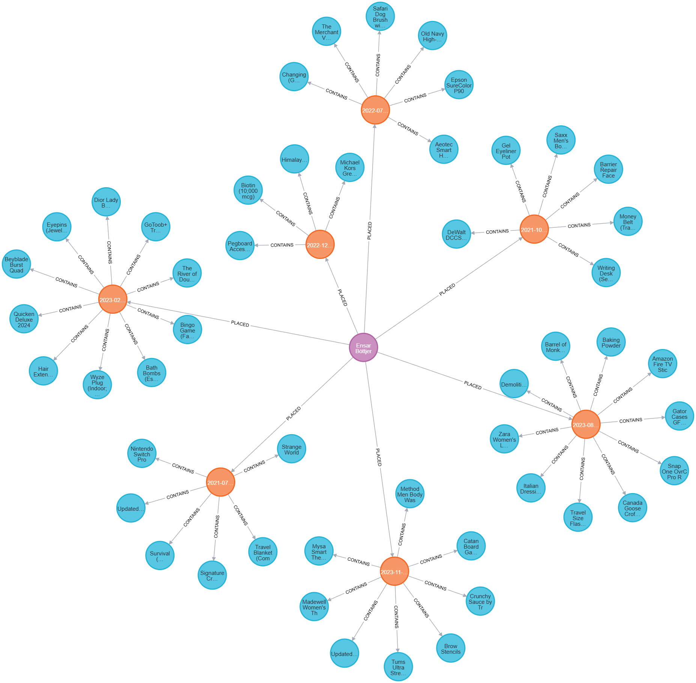

# Lab 3: Migration zu MongoDB
---

```
src/
├── database/
│   └── database.module.ts       # Dynamischer DB-Wechsel
├── repositories/
│   ├── interfaces/              # Abstrakte Verträge
│   ├── postgres/                # TypeORM Implementierung
│   └── mongodb/                 # Mongoose Implementierung
├── schemas/                     # MongoDB Schemas
├── entities/                    # PostgreSQL Entities
└── ...
```


## 1. Datenmodell
# MongoDB Collections

## Collection: `customers`

| Feld | Typ | Beschreibung |
|------|-----|--------------|
| `_id` | ObjectId | Automatisch generierte ID |
| `name` | String | Kundenname |
| `gender` | String | Geschlecht ("m" oder "f") |

## Collection: `products`

| Feld | Typ | Beschreibung |
|------|-----|--------------|
| `_id` | ObjectId | Automatisch generierte ID |
| `title` | String | Produktname |
| `category` | String | Kategorie |
| `price` | Number | Aktueller Preis |
| `in_stock` | Number | Lagerbestand |

## Collection: `orders`

| Feld | Typ | Beschreibung |
|------|-----|--------------|
| `_id` | ObjectId | Automatisch generierte ID |
| `customer_id` | ObjectId | Referenz auf customers Collection |
| `order_date` | Date | Bestelldatum |
| `positions` | Array | Eingebettete Bestellpositionen |
| `positions[].product_id` | ObjectId | Referenz auf products Collection |
| `positions[].quantity` | Number | Bestellmenge |
| `positions[].buying_price` | Number | Preis zum Kaufzeitpunkt |

## Collection: `category_stats`

| Feld | Typ | Beschreibung |
|------|-----|--------------|
| `category` | String | Produktkategorie |
| `products` | Number | Anzahl Produkte in dieser Kategorie |
| `orders` | Number | Anzahl Bestellungen mit Produkten dieser Kategorie |
| `revenue` | Number | Gesamtumsatz der Kategorie |
| `updated_at` | Date | Zeitpunkt der letzten Berechnung |

### Warum 3 statt 4 Collections?

Die `order_positions` Tabelle wurde in die `orders` Collection **eingebettet**, weil:

1. **Komposition**: Positionen gehören immer zu genau einer Bestellung
2. **Gemeinsamer Zugriff**: Bestellungen werden fast immer mit ihren Positionen abgefragt
3. **Performance**: Kein JOIN nötig - ein Dokument enthält alle Daten

---

### Beispieldokumente anzeigen

```bash
# Customer
docker-compose exec mongodb mongosh -u admin -p secret --authenticationDatabase admin ndbk --eval "db.customers.findOne()"

# Product
docker-compose exec mongodb mongosh -u admin -p secret --authenticationDatabase admin ndbk --eval "db.products.findOne()"

# Order (mit eingebetteten Positions)
docker-compose exec mongodb mongosh -u admin -p secret --authenticationDatabase admin ndbk --eval "db.orders.findOne()"

# Category Stats
docker-compose exec mongodb mongosh -u admin -p secret --authenticationDatabase admin ndbk --eval "db.category_stats.findOne()"
```

---

## 2. Import der Daten

```bash
# MongoDB starten
docker-compose up -d mongodb

# Daten importieren
docker-compose run --rm mongo-import
```

### Import-Ablauf

1. CSV-Dateien lesen aus `import/data/{SCENARIO}/`
2. ID-Mapping erstellen: PostgreSQL IDs → MongoDB ObjectIds
3. Collections befüllen: customers, products, orders
4. Positionen einbetten: order_positions werden direkt in orders eingebettet
5. Indizes erstellen
6. Analytics generieren: category_stats Collection vorberechnen
---

## 3. API mit Datenbankwechsel

### Datenbank wechseln

In `.env`:

```env
DB_TYPE=mongodb
```

Dann:

```bash
docker-compose up -d --build api
```

### API testen

```bash
# Orders abrufen
curl http://localhost:3000/orders

# Einzelne Order
curl http://localhost:3000/orders/{order_id}

# Neue Order erstellen
curl -X POST http://localhost:3000/orders -H "Content-Type: application/json" -d "{\"orderDate\": \"2025-01-15T00:00:00Z\", \"customerId\": \"{customer_id}\", \"positions\": [{\"productId\": \"{product_id}\", \"quantity\": 2, \"buyingPrice\": 99.99}]}"

# Einzelnes Produkt abrufen
curl http://localhost:3000/products/{product_id}

# Produkt aktualisieren
curl -X PATCH http://localhost:3000/products/{product_id} -H "Content-Type: application/json" -d "{\"price\": 149.99, \"in_stock\": 50}"

# Produkt löschen
curl -X DELETE http://localhost:3000/products/{product_id}

# Analytics
curl http://localhost:3000/analytics

# Analytics neu berechnen (nur MongoDB)
curl -X POST http://localhost:3000/analytics/refresh
```

---

# Lab 3: Migration zu Neo4j
## 1. Datenmodell (relational → graphbasiert)

### Relationales Modell

| Tabelle         | Beschreibung      |
| --------------- | ----------------- |
| customers       | Kundendaten       |
| products        | Produktdaten      |
| orders          | Bestellungen      |
| order_positions | Bestellpositionen |

### Neo4j Graph-Modell

| Knoten (Nodes)  | Eigenschaften                        |
| --------------- | ------------------------------------ |
| `Customer`      | id, name, gender                     |
| `Order`         | id, order_date                       |
| `Product`       | id, title, category, price, in_stock |
| `CategoryStats` | category, products, orders, revenue  |

| Beziehung (Edges)                  | Bedeutung             |
| ---------------------------------- | --------------------- |
| `(:Customer)-[:PLACED]->(:Order)`  | Kunde bestellt Order  |
| `(:Order)-[:CONTAINS]->(:Product)` | Order enthält Produkt |

---

## 2. Datenimport

Import aus CSV nur, wenn Neo4j noch leer ist:

```bash
docker compose run --rm neo4j-import
```

CSV-Quelle:

```
/data/amzn/
```

### Ablauf im Importer

| Schritt                    | Ergebnis                             |
| -------------------------- | ------------------------------------ |
| CSVs einlesen              | Kunden, Produkte, Orders, Positionen |
| Knoten erzeugen            | Customer, Product, Order             |
| Beziehungen erzeugen       | PLACED, CONTAINS                     |
| CategoryStats vorberechnen | Performance-Optimierung              |

## 3️. Vorberechnete Neo4j Analytics (Materialized View Konzept)

Zur Performance-Optimierung wurde `CategoryStats` einmal vorher berechnet und als Knoten angelegt:

#### Cypher:

```cypher
MATCH (c:Customer)-[:PLACED]->(o:Order)-[r:CONTAINS]->(p:Product)
        WITH
          p.category AS category,
          count(DISTINCT p) AS productsCount,
          count(DISTINCT o) AS ordersCount,
          sum(toFloat(r.quantity) * toFloat(r.buying_price)) AS revenue
        MERGE (cs:CategoryStats { category: category })
        SET cs.products = productsCount,
            cs.orders   = ordersCount,
            cs.revenue  = revenue
```


---

## 4️. API-Konfiguration und DB-Umschaltung

`.env`:

```env
DB_TYPE=neo4j
```

Die API nutzt **Repositories**:

| Interface              | Neo4j-Implementierung    |
| ---------------------- | ------------------------ |
| `IProductRepository`   | Neo4jProductRepository   |
| `IOrderRepository`     | Neo4jOrderRepository     |
| `IAnalyticsRepository` | Neo4jAnalyticsRepository |

---

## 5️. Endpunkte testen

### REST

```
http://localhost:3000/orders
http://localhost:3000/products/zfdoss
http://localhost:3000/analytics
http://localhost:3000/orders?page=1&pageSize=2&customerName=Tim
```
### PATCH,DELETE
```
PATCH http://localhost:3000/products/ctamai
Content-Type: application/json

{
  "title": "New Title",
  "price": 12,
  "in_stock": 5
}

DELETE  http://localhost:3000/products/ctamai

```

### GraphQL Playground

```graphql
query {
      order(id: ?) {
      id
    order_date
    customer {
      name
    }
    positions { 
      quantity
      buying_price
      product {
        title
        category   
      }
    }
  }
}
```

---

## 6️. Graph-Visualisierung

```cypher
MATCH (c:Customer)-[:PLACED]->(o:Order)-[:CONTAINS]->(p:Product)
RETURN c, o, p LIMIT 50;
```



---

## 7️. Lasttest (Locust)

Failed leider noch Problem hat wahrscheinlich mit Memory Problem zu tun.


---

## 8️. Struktur Neo4j

```
src/
├── database/
│   └── database.module.ts
├── repositories/
│   ├── neo4j/
│   │   ├── product.repository.ts
│   │   ├── order.repository.ts
│   │   ├── analytics.repository.ts
│   │   └── index.ts
└── ...
```